# API Hermandad · Gestión de una Hermandad

> **En una frase:** este proyecto es el "cerebro" de una aplicación para gestionar una hermandad: guarda a los hermanos, organiza los grupos del cortejo, reparte a cada persona en su sitio para cada salida, publica noticias y eventos en un calendario, y controla quién puede ver o cambiar cada cosa.

    

---

## 📑 Índice

1. [¿Qué es esto? (explicado para todos)](#1-qué-es-esto-explicado-para-todos)
2. [Vocabulario: de la hermandad y de la informática](#2-vocabulario-de-la-hermandad-y-de-la-informática)
3. [¿Qué se puede hacer con la API?](#3-qué-se-puede-hacer-con-la-api)
4. [Quién es quién: los roles y sus permisos](#4-quién-es-quién-los-roles-y-sus-permisos)
5. [Cómo está construida por dentro](#5-cómo-está-construida-por-dentro)
6. [Tecnologías utilizadas](#6-tecnologías-utilizadas)
7. [Mapa de carpetas y archivos](#7-mapa-de-carpetas-y-archivos)
8. [La información que se guarda (base de datos)](#8-la-información-que-se-guarda-base-de-datos)
9. [Seguridad: cómo se entra y cómo se protege](#9-seguridad-cómo-se-entra-y-cómo-se-protege)
10. [Catálogo completo de direcciones (endpoints)](#10-catálogo-completo-de-direcciones-endpoints)
11. [Los procesos importantes, paso a paso](#11-los-procesos-importantes-paso-a-paso)
12. [Reglas de negocio](#12-reglas-de-negocio)
13. [Cuando algo sale mal: errores](#13-cuando-algo-sale-mal-errores)
14. [Cómo ponerla en marcha](#14-cómo-ponerla-en-marcha)
15. [Configuración](#15-configuración)
16. [Datos de ejemplo incluidos](#16-datos-de-ejemplo-incluidos)
17. [Problemas conocidos y puntos a mejorar](#17-problemas-conocidos-y-puntos-a-mejorar)
18. [Ideas para el futuro](#18-ideas-para-el-futuro)
19. [Preguntas frecuentes](#19-preguntas-frecuentes)

---

## 1. ¿Qué es esto? (explicado para todos)

Imagina la secretaría de una hermandad. Allí hay:

- un **fichero de hermanos** (nombre, DNI, dirección, teléfono, correo…),
- una lista de **grupos** que forman el cortejo (Cruz de Guía, nazarenos, acólitos, pasos, bandas…),
- un **cuadrante** que dice qué hermano va en qué grupo en cada salida,
- un **tablón de anuncios** con noticias,
- un **calendario** con ensayos, traslados, convivencias…

Este proyecto es todo eso, pero digital. Es una **API**: un programa que **no tiene pantallas**, sino que funciona como una "ventanilla" a la que otras aplicaciones (una web, una app de móvil) le hacen peticiones del tipo *"dame las noticias"* o *"apunta a este hermano en la Cruz de Guía para el Martes Santo"*. La API comprueba quién lo pide, si tiene permiso, guarda o busca la información en la base de datos y contesta.

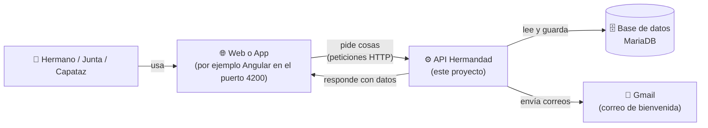

> 💡 **Analogía:** la web es el **camarero** que habla contigo, la API es la **cocina** que prepara los platos, y la base de datos es la **despensa** donde está guardado todo.

La aplicación web que usa esta API **no está en este repositorio**; por la configuración se deduce que es una aplicación Angular que se ejecuta en `http://localhost:4200`.

---

## 2. Vocabulario: de la hermandad y de la informática

### 2.1. Términos de la hermandad (tal como se usan en el proyecto)

| Término | Qué significa en la vida real | Cómo lo representa la API |
|---|---|---|
| **Hermano / Usuario** | Persona que pertenece a la hermandad | Tabla `usuario` |
| **Junta (de gobierno)** | Personas que dirigen la hermandad | Rol `junta` |
| **Capataz** | Persona que dirige a los costaleros de un paso | Rol `capataz` |
| **Grupo** | Cada parte del cortejo: Cruz de Guía, nazarenos, acólitos, paso, banda… | Tabla `grupo` |
| **Tramo** | Una salida concreta (con fecha de salida y de entrada). Por ejemplo, "Salida procesional del Martes" | Tabla `tramo` |
| **Asignación** | Decir que "Fulano va en el grupo X durante el tramo Y" | Tabla `tramo_grupo_usuario` |
| **Evento** | Algo que aparece en el calendario: ensayo, igualá, traslado, fiesta… | Tabla `evento` |
| **Noticia** | Un anuncio del tablón, con título, texto e imagen | Tabla `noticia` |
| **Igualá** | Reunión en la que el capataz coloca a los costaleros bajo el paso según su altura | Aparece como evento de ejemplo |

### 2.2. Términos informáticos (sin tecnicismos)

| Término | Explicación sencilla |
|---|---|
| **API** | Ventanilla de atención para programas. No tiene botones ni pantallas: recibe peticiones y devuelve respuestas. |
| **Endpoint** (o "dirección") | Cada una de las "ventanillas" concretas, por ejemplo `/api/news/all` para ver todas las noticias. |
| **Petición HTTP** | El mensaje que la web envía a la API. Tiene un **método** que indica la intención. |
| **GET / POST / PUT / DELETE** | Los cuatro "verbos": **GET** = consultar, **POST** = crear, **PUT** = modificar, **DELETE** = borrar. |
| **JSON** | El formato de texto en que viajan los datos, del estilo `{"nombre": "Juan"}`. |
| **Base de datos** | El archivador donde se guarda toda la información de forma ordenada en tablas. |
| **Token** | Una "pulsera de acceso" que te dan al iniciar sesión. Hay que enseñarla en cada petición protegida. |
| **JWT** | El formato concreto del token: un texto largo firmado digitalmente. |
| **Sesión** | El registro, guardado en la base de datos, de que alguien ha entrado y con qué pulsera. |
| **Huella (fingerprint)** | Una "foto" del dispositivo desde el que entraste (dirección IP + navegador), para evitar que otro use tu pulsera. |
| **Hash / BCrypt** | Forma de guardar las contraseñas "trituradas": no se pueden leer, solo comprobar si coinciden. |
| **Rol** | El "cargo" de cada usuario, que decide qué puede hacer. |
| **DTO** | Un "formulario" con los datos exactos que entran o salen por la API (sin datos internos de más). |
| **Docker** | Herramienta que mete el programa y la base de datos en "cajas" listas para funcionar en cualquier ordenador. |
| **Swagger** | Una página web generada automáticamente donde ver y probar todas las direcciones de la API. |
| **CORS** | Lista de webs autorizadas a hablar con la API desde un navegador. |

---

## 3. ¿Qué se puede hacer con la API?

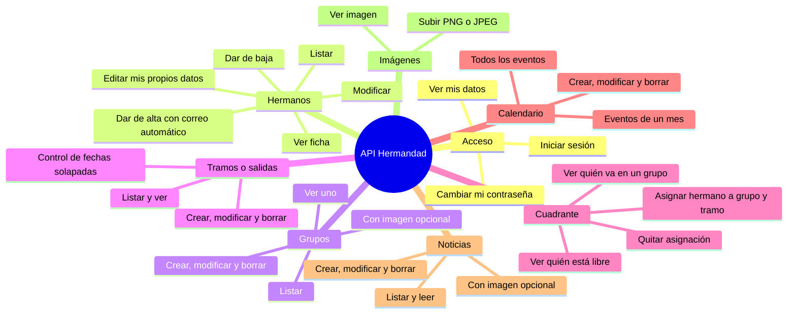

| Módulo | Para qué sirve | ¿Necesita iniciar sesión para consultar? |
|---|---|---|
| 🔐 **Autenticación** | Entrar en el sistema y saber quién eres | Solo para "ver mis datos" |
| 👥 **Usuarios** | Fichero de hermanos | Sí |
| 🏷️ **Grupos** | Partes del cortejo | Sí |
| 📅 **Tramos** | Salidas procesionales | Sí |
| 🧩 **Asignaciones** | Cuadrante: quién va dónde en cada salida | Sí |
| 🗓️ **Eventos** | Calendario de actividades | **No** (público) |
| 📰 **Noticias** | Tablón de anuncios | **No** (público) |
| 🖼️ **Imágenes** | Fotos de noticias y grupos | **No** para verlas, sí para subirlas |

---

## 4. Quién es quién: los roles y sus permisos

Hay **cuatro roles**. Cada usuario tiene uno.

| Rol | Quién suele ser | Resumen de lo que puede hacer |
|---|---|---|
| 🛡️ `admin` | El responsable técnico o el hermano mayor | **Todo**, incluido gestionar los tramos (salidas) |
| 🏛️ `junta` | Miembros de la junta de gobierno | Gestionar hermanos, grupos, noticias, eventos y cuadrantes |
| 🎯 `capataz` | Capataces y auxiliares | Gestionar eventos y cuadrantes, ver el listado de hermanos y grupos |
| 🙋 `usuario` | Hermano de a pie (rol por defecto) | Ver información y editar sus propios datos y contraseña |
| 🌍 *Visitante* | Cualquiera sin iniciar sesión | Ver eventos, noticias e imágenes |

En el código hay dos "atajos" de permisos reutilizables:

- **`@AllowedRoles`** → solo `admin` y `junta`.
- **`@AllEditRoles`** → `admin`, `junta` y `capataz`.

### 4.1. Matriz completa de permisos

✅ = permitido · ❌ = prohibido

| Acción | Visitante | usuario | capataz | junta | admin |
|---|:-:|:-:|:-:|:-:|:-:|
| Iniciar sesión | ✅ | ✅ | ✅ | ✅ | ✅ |
| Ver mis datos (`/api/auth/me`) | ❌ | ✅ | ✅ | ✅ | ✅ |
| Editar mis datos (email, teléfono, dirección) | ❌ | ✅ | ✅ | ✅ | ✅ |
| Cambiar mi contraseña | ❌ | ✅ | ✅ | ✅ | ✅ |
| Ver listado de todos los hermanos | ❌ | ❌ | ✅ | ✅ | ✅ |
| Ver ficha de un hermano concreto | ❌ | ❌ | ❌ | ✅ | ✅ |
| Dar de alta / modificar / dar de baja hermanos | ❌ | ❌ | ❌ | ✅ | ✅ |
| Ver listado de grupos | ❌ | ✅ | ✅ | ✅ | ✅ |
| Ver un grupo concreto | ❌ | ❌ | ✅ | ✅ | ✅ |
| Crear / modificar / borrar grupos | ❌ | ❌ | ❌ | ✅ | ✅ |
| Ver tramos | ❌ | ✅ | ✅ | ✅ | ✅ |
| Crear / modificar / borrar tramos | ❌ | ❌ | ❌ | ❌ | ✅ |
| Gestionar el cuadrante (asignar, ver, quitar) | ❌ | ❌ | ✅ | ✅ | ✅ |
| Ver eventos | ✅ | ✅ | ✅ | ✅ | ✅ |
| Crear / modificar / borrar eventos | ❌ | ❌ | ✅ | ✅ | ✅ |
| Ver noticias | ✅ | ✅ | ✅ | ✅ | ✅ |
| Crear / modificar / borrar noticias | ❌ | ❌ | ❌ | ✅ | ✅ |
| Ver imágenes | ✅ | ✅ | ✅ | ✅ | ✅ |
| Subir imágenes | ❌ | ✅ | ✅ | ✅ | ✅ |

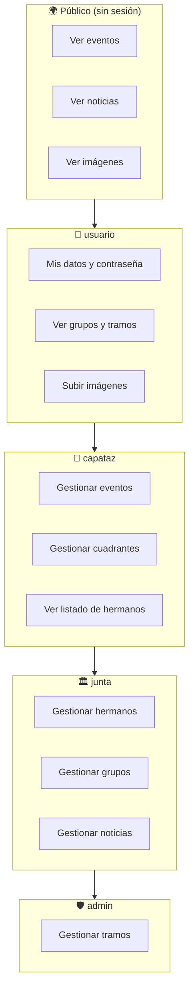

*Cada nivel puede hacer lo suyo **más** todo lo de los niveles anteriores.*

---

## 5. Cómo está construida por dentro

El proyecto está organizado en **capas**, como un edificio en el que cada planta tiene un trabajo distinto. Así, si hay que cambiar algo de una planta, no hace falta tocar las demás.

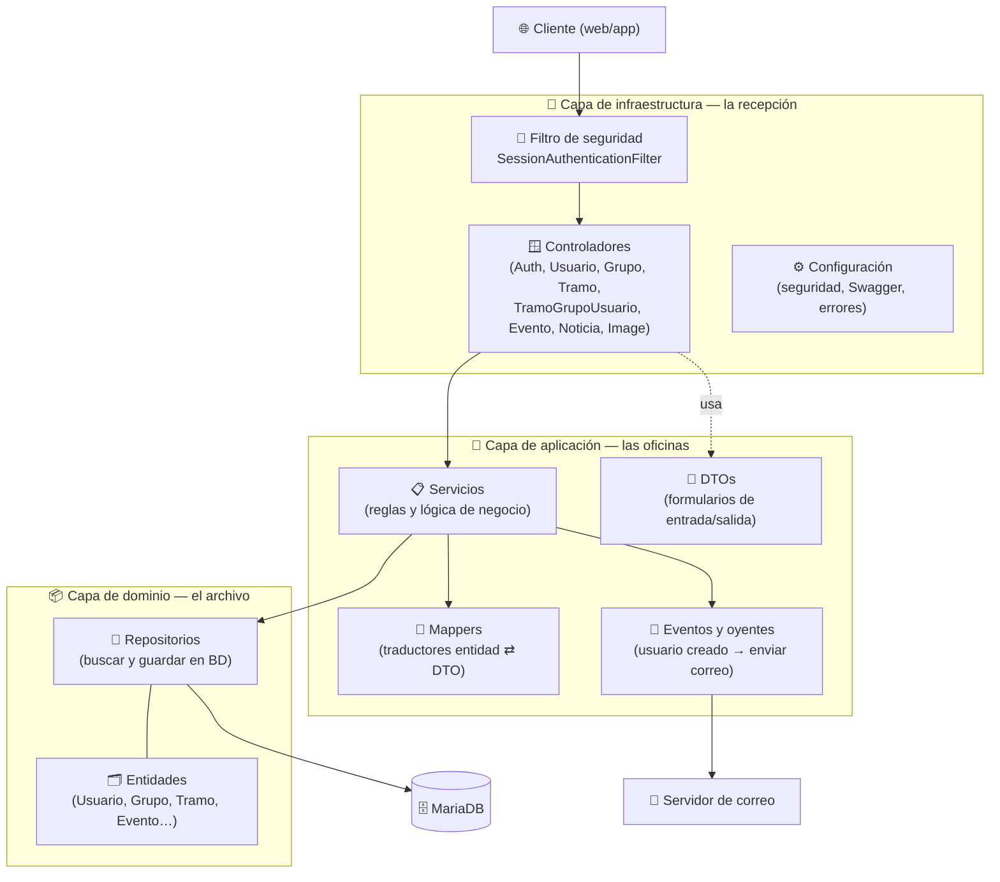

| Capa | Carpeta | Qué hace | Analogía |
|---|---|---|---|
| **Infraestructura** | `infrastructure/` | Recibe las peticiones, comprueba la "pulsera", decide si tienes permiso y devuelve la respuesta | La recepción y el guardia de seguridad |
| **Aplicación** | `application/` | Aplica las reglas: "no se puede asignar a alguien dos veces en el mismo tramo", "la contraseña nueva no puede ser igual a la vieja"… | Las oficinas donde se tramita todo |
| **Dominio** | `domain/` | Define cómo es cada cosa (un usuario tiene nombre, DNI…) y cómo se guarda | El archivo con las fichas |
| **Utilidades** | `utils/` | Herramientas comunes: generar contraseñas, comprimir imágenes, validar fechas, mensajes de error | La caja de herramientas |

### 5.1. Viaje de una petición

Así recorre el sistema la petición *"crear una noticia"*:

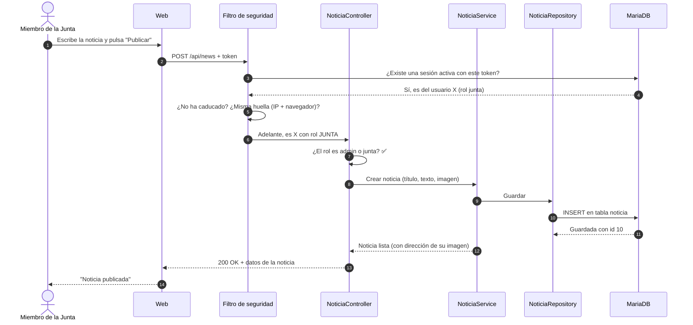

---

## 6. Tecnologías utilizadas

| Tecnología | Versión | Para qué se usa (en cristiano) |
|---|---|---|
| **Java** | 17 | El lenguaje de programación en el que está escrito todo |
| **Spring Boot** | 4.0.2 | El "esqueleto" que da hecho lo básico de un servidor web |
| Spring Web MVC | (incluido) | Atender las peticiones HTTP |
| Spring Data JPA / Hibernate | (incluido) | Hablar con la base de datos sin escribir SQL a mano |
| Spring Security | (incluido) | Controlar quién entra y qué puede hacer |
| Spring Mail | (incluido) | Enviar correos electrónicos |
| **MariaDB** | LTS (cliente JDBC) | La base de datos |
| **JJWT** | 0.11.5 | Fabricar los tokens (pulseras de acceso) |
| **BCrypt** | (Spring Security) | "Triturar" las contraseñas antes de guardarlas |
| **MapStruct** | 1.6.3 | Traducir automáticamente entre fichas internas y formularios |
| **Lombok** | 1.18.42 | Ahorrar código repetitivo (getters, setters, constructores…) |
| **springdoc-openapi** | 3.0.1 | Generar la página Swagger con la documentación interactiva |
| **Maven** (wrapper) | 3.9.12 | Descargar dependencias y compilar el proyecto |
| **Docker / Docker Compose** | — | Arrancar base de datos y API con un solo comando |
| **Gmail SMTP** | — | Servidor que envía los correos de bienvenida |

---

## 7. Mapa de carpetas y archivos

```text
GestionUser-API/
├── 📄 pom.xml                      ← Lista de "ingredientes" (dependencias) y cómo compilar
├── 📄 mvnw / mvnw.cmd              ← Maven portátil (Mac/Linux y Windows)
├── 📁 .mvn/wrapper/                ← Configuración del Maven portátil
├── 🐳 Dockerfile                   ← Receta para meter la API en una "caja" Docker
├── 🐳 docker-compose.yml           ← Arranca base de datos + API juntas
├── 🔐 .env.example                 ← Plantilla de claves secretas (copiar como .env)
├── 🔐 .env                         ← Tus claves reales (NO se sube a git)
├── 📁 bbdd/
│   └── hermandad.sql               ← Copia completa de la BD (con más usuarios de prueba)
├── 📁 docker/init/
│   ├── 01_schema.sql               ← Crea la BD y la rellena con datos de ejemplo (lo usa Docker)
│   └── 02_data.sql                 ← Solo inserta el usuario admin (no lo usa Docker)
└── 📁 src/main/
    ├── 📁 resources/
    │   ├── application.yml         ← Configuración para ejecutar en tu ordenador
    │   └── application-docker.yml  ← Configuración para ejecutar dentro de Docker
    └── 📁 java/com/example/apihermandad/
        ├── ApiHermandadApplication.java   ← El botón de "encendido"
        ├── ServletInitializer.java        ← Permite desplegar en un servidor Tomcat externo
        ├── 📁 infrastructure/
        │   ├── 📁 config/        ← Seguridad, Swagger y gestión de errores
        │   ├── 📁 controller/    ← Las "ventanillas" (8 controladores)
        │   └── 📁 security/      ← Filtro de token, atajos de roles, respuestas 401/403
        ├── 📁 application/
        │   ├── 📁 dto/           ← 19 formularios de entrada/salida
        │   ├── 📁 services/      ← 10 servicios con la lógica
        │   ├── 📁 mapper/        ← 6 traductores
        │   ├── 📁 events/        ← Aviso "se ha creado un usuario"
        │   └── 📁 listeners/     ← Quien escucha ese aviso y manda el correo
        ├── 📁 domain/
        │   ├── 📁 entity/        ← 8 fichas (tablas)
        │   └── 📁 repository/    ← 8 buscadores/guardadores
        └── 📁 utils/             ← Mensajes, contraseñas, compresión, fechas
```

### 7.1. Inventario de piezas

| Tipo | Cantidad | Nombres |
|---|:-:|---|
| Controladores | 8 | `AuthController`, `UsuarioController`, `GrupoController`, `TramoController`, `TramoGrupoUsuarioController`, `EventoController`, `NoticiaController`, `ImageController` |
| Servicios | 10 | `AuthService`, `JwtService`, `UsuarioService`, `EmailService`, `GrupoService`, `TramoService`, `TramoGrupoUsuarioService`, `EventoService`, `NoticiaService`, `ImageService` |
| Entidades | 8 | `Usuario`, `Sesion`, `Grupo`, `Tramo`, `TramoGrupoUsuario`, `Evento`, `Noticia`, `Image` |
| Repositorios | 8 | Uno por entidad |
| Mappers | 6 | `UsuarioMapper`, `PasswordMapper`, `GrupoMapper`, `TramoMapper`, `EventoMapper`, `NoticiaMapper` |
| DTOs | 19 | Ver [sección 10](#10-catálogo-completo-de-direcciones-endpoints) |
| Utilidades | 3 | `HttpMessage` (textos de error), `MethodUtils` (imágenes y fechas), `PasswordManager` (contraseñas aleatorias) |
| Seguridad | 5 | `SessionAuthenticationFilter`, `AllowedRoles`, `AllEditRoles`, `RestAuthenticationEntryPoint`, `RestAccessDeniedHandler` |
| Configuración | 3 | `SecurityConfig`, `OpenApiConfig`, `GlobalExceptionHandler` |
| Tests automáticos | 0 | *No hay carpeta `src/test`* |

---

## 8. La información que se guarda (base de datos)

La base de datos se llama **`hermandad`** y tiene **8 tablas**.

### 8.1. Mapa de relaciones

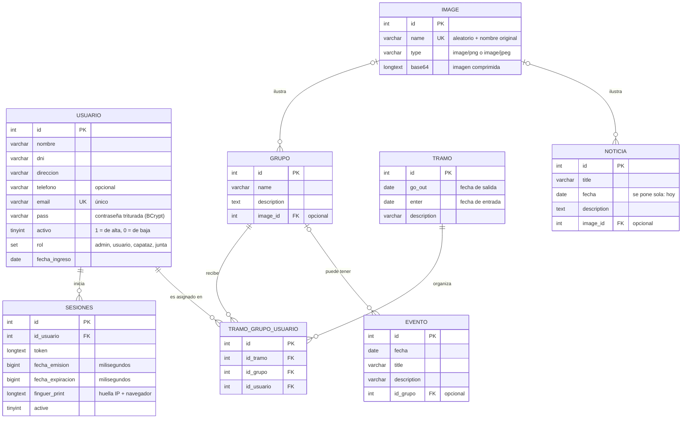

### 8.2. Explicación de cada tabla

| Tabla | Qué guarda | Detalles importantes |
|---|---|---|
| `usuario` | Ficha de cada hermano | El email no se puede repetir. La contraseña nunca se guarda tal cual. Al dar de baja **no se borra**: se marca `activo = 0`. |
| `sesiones` | Cada inicio de sesión | Guarda el token, cuándo se emitió, cuándo caduca, la huella del dispositivo y si sigue activa. Si se borra un usuario, se borran sus sesiones. |
| `grupo` | Partes del cortejo | Puede llevar una imagen. |
| `tramo` | Salidas | Fecha de salida (`go_out`), de entrada (`enter`) y descripción. |
| `tramo_grupo_usuario` | El cuadrante | Une un tramo + un grupo + un hermano. No puede repetirse la misma combinación. |
| `evento` | Calendario | Puede estar ligado a un grupo (p. ej. ensayo del Paso Cristo) o ser general (sin grupo). |
| `noticia` | Tablón | La fecha se rellena sola con el día de creación. Puede llevar imagen. |
| `image` | Fotos | Se guardan **dentro de la base de datos**, comprimidas y convertidas a texto. |

### 8.3. ¿Qué pasa al borrar algo?

| Si borras… | …entonces | Motivo |
|---|---|---|
| Un **usuario** (directamente en BD) | Se borran sus sesiones y sus asignaciones | `ON DELETE CASCADE` |
| Un **grupo** | Se borran sus eventos, sus asignaciones y su imagen | Cascada en BD + lógica del servicio |
| Un **tramo** con asignaciones | ❌ **Error**: la BD no lo permite | La relación tramo → asignación no tiene cascada |
| Una **noticia** | Se borra también su imagen | Lógica del servicio |
| Un **evento** | Solo el evento | — |

> ℹ️ Desde la API, "borrar" un usuario (`DELETE /api/usuario/{id}`) en realidad solo lo **da de baja** (`activo = 0`); no se elimina.

### 8.4. Cómo se guardan las imágenes

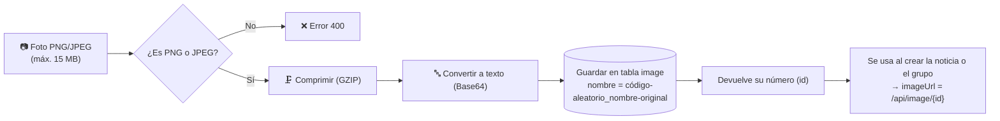

Para verla, `GET /api/image/{id}` hace el camino inverso (texto → descomprimir → imagen original) y la devuelve con su tipo correcto para que el navegador la muestre.

---

## 9. Seguridad: cómo se entra y cómo se protege

### 9.1. Iniciar sesión

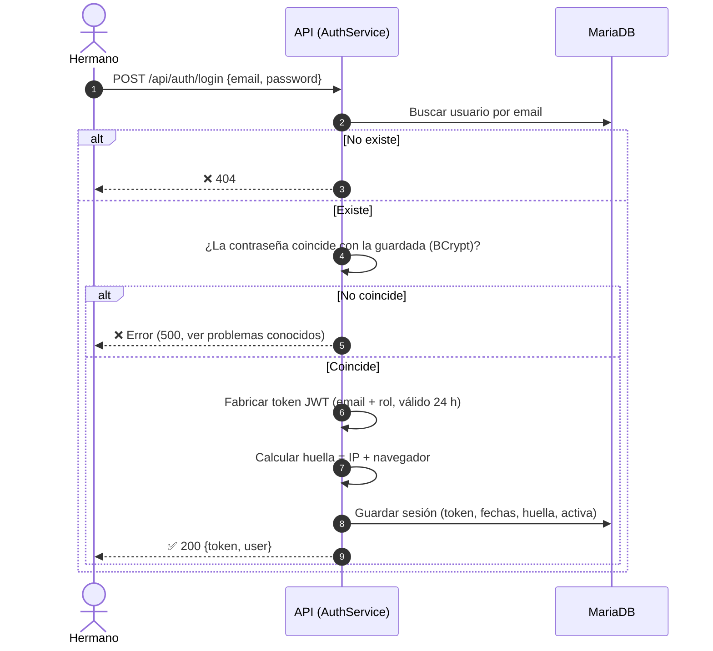

Respuesta de ejemplo:

```json
{
  "token": "eyJhbGciOiJIUzI1NiJ9.eyJzdWIiOiJhZG1pbkBlbWFpbC5jb20i...",
  "user": {
    "id": 2,
    "name": "admin",
    "dni": "23456789A",
    "address": "calle falsa 12",
    "phone": "123123123",
    "email": "admin@email.com",
    "active": true,
    "role": "admin",
    "createDate": "2026-02-01"
  }
}
```

### 9.2. Usar la "pulsera" en cada petición

Después de entrar, cada petición protegida debe llevar la cabecera:

```
Authorization: Bearer <token>
```

El **filtro de seguridad** hace estas comprobaciones, en este orden:

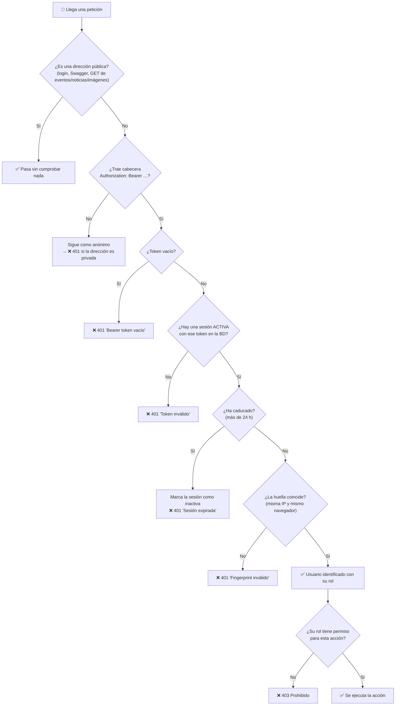

**Puntos clave:**

- La validez del token se comprueba **mirando la tabla `sesiones`**, no solo la firma. Eso permite "anular" pulseras desde el servidor (por ejemplo, al cambiar la contraseña).
- La **huella** se calcula con la **IP + el navegador**. Si cambias de red (de wifi a datos móviles) o de navegador, la sesión deja de valer y hay que volver a entrar.
- Las sesiones duran **24 horas** (`86400000` milisegundos).

### 9.3. Vida de una sesión

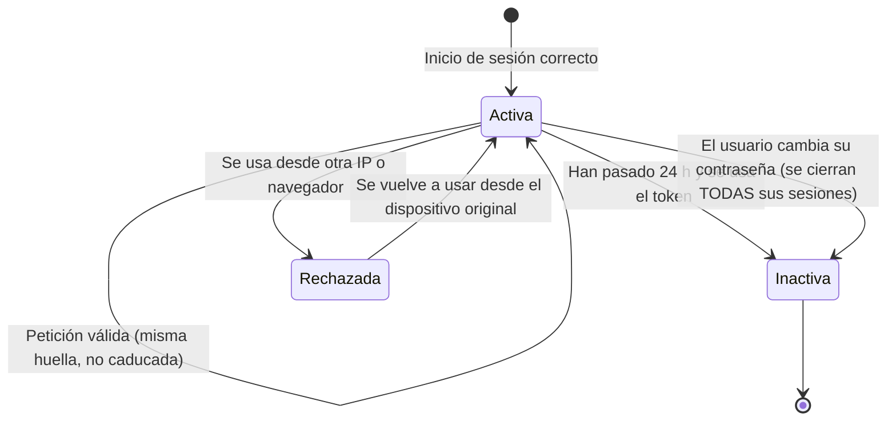

### 9.4. Otras medidas de seguridad

| Medida | Cómo está implementada |
|---|---|
| Contraseñas protegidas | Se guardan con **BCrypt** (irreversible) |
| Contraseñas iniciales aleatorias | Formato `XXXXX-XXXXX-XXXXX`, con letras y números que no se confunden (sin `0`, `O`, `1`, `l`, `I`) |
| Sin estado en el servidor | Cada petición se valida por sí sola (`STATELESS`) |
| CSRF desactivado | Normal en APIs que usan token en cabecera |
| CORS | Solo se permiten peticiones de navegador desde `http://localhost:4200` (y dos direcciones de red local de ejemplo sin completar) |
| Respuestas de error en JSON | 401 y 403 devuelven siempre un JSON con el mismo formato |
| Límite de subida | 15 MB por archivo y por petición |

---

## 10. Catálogo completo de direcciones (endpoints)

Todas las direcciones empiezan por `http://localhost:8080`.

**Leyenda de permisos:** 🌍 Público · 🔑 Cualquiera con sesión · 🎯 admin/junta/capataz · 🏛️ admin/junta · 🛡️ solo admin

### 10.1. 🔐 Autenticación — `/api/auth`

| Método | Dirección | Permiso | Qué hace | Envía | Recibe |
|---|---|:-:|---|---|---|
| POST | `/api/auth/login` | 🌍 | Iniciar sesión | `{ "email", "password" }` | `{ "token", "user" }` |
| GET | `/api/auth/me` | 🔑 | Ver mis propios datos | — | Ficha de usuario |

### 10.2. 👥 Usuarios — `/api/usuario`

| Método | Dirección | Permiso | Qué hace | Envía | Recibe |
|---|---|:-:|---|---|---|
| GET | `/api/usuario/all` | 🎯 | Listar todos los hermanos | — | Lista de fichas |
| GET | `/api/usuario/{id}` | 🏛️ | Ver la ficha de un hermano | — | Ficha |
| POST | `/api/usuario` | 🏛️ | Dar de alta (genera contraseña y manda correo) | Ficha sin id | Ficha creada |
| PUT | `/api/usuario/{id}` | 🏛️ | Modificar todos los datos (incluido rol y alta/baja) | Ficha completa | Ficha actualizada |
| PUT | `/api/usuario/me` | 🔑 | Modificar **mis** email, teléfono y dirección | `{ "email", "phone", "address" }` | Mi ficha |
| PUT | `/api/usuario/me/password` | 🔑 | Cambiar **mi** contraseña | `{ "oldPassword", "newPassword", "confirmPassword" }` | 204 (sin contenido) |
| DELETE | `/api/usuario/{id}` | 🏛️ | Dar de baja (no borra, pone `activo = false`) | — | 204 |

**Ficha de usuario (`UsuarioDto`):**

| Campo | Tipo | Ejemplo | Notas |
|---|---|---|---|
| `id` | número | `2` | Lo pone el sistema |
| `name` | texto | `"Juan Pérez"` | Obligatorio |
| `dni` | texto | `"12345678Z"` | Obligatorio |
| `address` | texto | `"Calle Real 1"` | Obligatorio |
| `phone` | texto | `"600000000"` | Opcional |
| `email` | texto | `"juan@correo.com"` | Obligatorio y único |
| `active` | sí/no | `true` | Al crear siempre `true` |
| `role` | texto | `"usuario"` | `admin`, `junta`, `capataz` o `usuario` (por defecto `usuario`) |
| `createDate` | fecha | `"2026-02-01"` | Al crear se pone la de hoy |

Ejemplo de alta:

```json
POST /api/usuario
{
  "name": "Juan Pérez",
  "dni": "12345678Z",
  "address": "Calle Real 1",
  "phone": "600000000",
  "email": "juan@correo.com",
  "role": "usuario"
}
```

### 10.3. 🏷️ Grupos — `/api/grupos`

| Método | Dirección | Permiso | Qué hace | Envía | Recibe |
|---|---|:-:|---|---|---|
| GET | `/api/grupos` | 🔑 | Listar grupos | — | Lista |
| GET | `/api/grupos/{id}` | 🎯 | Ver un grupo | — | Grupo |
| POST | `/api/grupos` | 🏛️ | Crear grupo | `{ "name", "description", "imageId" }` | Grupo |
| PUT | `/api/grupos/{id}` | 🏛️ | Modificar (si cambias la imagen, se borra la anterior) | Igual | Grupo |
| DELETE | `/api/grupos/{id}` | 🏛️ | Borrar grupo y su imagen | — | 204 |

Respuesta: `{ "id": 8, "name": "Paso Virgen", "description": "…", "imageUrl": "/api/image/16" }`

### 10.4. 📅 Tramos — `/api/tramos`

| Método | Dirección | Permiso | Qué hace | Envía | Recibe |
|---|---|:-:|---|---|---|
| GET | `/api/tramos/all` | 🔑 | Listar tramos | — | Lista |
| GET | `/api/tramos/{id}` | 🔑 | Ver un tramo | — | Tramo |
| POST | `/api/tramos` | 🛡️ | Crear tramo (valida fechas) | `{ "goOut", "enter", "description" }` | Tramo |
| PUT | `/api/tramos/{id}` | 🛡️ | Modificar tramo (valida fechas) | Igual | Tramo |
| DELETE | `/api/tramos/{id}` | 🛡️ | Borrar tramo | — | 204 |

Ejemplo: `{ "goOut": "2026-03-31", "enter": "2026-03-31", "description": "Martes Santo" }`

### 10.5. 🧩 Cuadrante (asignaciones) — `/api/tramo-grupo-usuario`

| Método | Dirección | Permiso | Qué hace | Envía | Recibe |
|---|---|:-:|---|---|---|
| POST | `/api/tramo-grupo-usuario` | 🎯 | Asignar un hermano a un grupo en un tramo | `{ "tramoId", "grupoId", "usuarioId" }` | 200 vacío |
| GET | `/api/tramo-grupo-usuario/usuarios?grupoId=&tramoId=` | 🎯 | ¿Quién va en este grupo en este tramo? | — | `[{ "id", "nombre", "email" }]` |
| GET | `/api/tramo-grupo-usuario/usuarios-disponibles?grupoId=&tramoId=` | 🎯 | ¿Quién **no** está en este grupo en este tramo? | — | `[{ "id", "nombre", "email" }]` |
| DELETE | `/api/tramo-grupo-usuario?tramoId=&grupoId=&usuarioId=` | 🎯 | Quitar una asignación | — | 204 |

### 10.6. 🗓️ Eventos — `/api/events`

| Método | Dirección | Permiso | Qué hace | Envía | Recibe |
|---|---|:-:|---|---|---|
| GET | `/api/events/all` | 🌍 | Todos los eventos | — | Lista |
| GET | `/api/events/month?year=2026&month=3` | 🌍 | Eventos de un mes (mes del 1 al 12) | — | Lista |
| POST | `/api/events` | 🎯 | Crear evento | `{ "title", "description", "fecha", "grupoId" }` | Evento |
| PUT | `/api/events/{id}` | 🎯 | Modificar (si `grupoId` es `null`, se le quita el grupo) | Igual | Evento |
| DELETE | `/api/events/{id}` | 🎯 | Borrar | — | 204 |

Respuesta: `{ "id": 2, "title": "Ensayo", "description": "…", "fecha": "2026-02-21", "grupoId": 4, "grupoNombre": "Paso Cristo" }`

### 10.7. 📰 Noticias — `/api/news`

| Método | Dirección | Permiso | Qué hace | Envía | Recibe |
|---|---|:-:|---|---|---|
| GET | `/api/news/all` | 🌍 | Todas las noticias | — | Lista |
| GET | `/api/news/{id}` | 🌍 | Una noticia | — | Noticia |
| POST | `/api/news` | 🏛️ | Crear | `{ "title", "description", "imageId" }` | Noticia |
| PUT | `/api/news/{id}` | 🏛️ | Modificar (si cambias la imagen, se borra la anterior) | Igual | Noticia |
| DELETE | `/api/news/{id}` | 🏛️ | Borrar noticia y su imagen | — | 204 |

Respuesta: `{ "id": 9, "title": "…", "description": "…", "imageUrl": "/api/image/9" }` *(la fecha se guarda pero no se devuelve)*

### 10.8. 🖼️ Imágenes — `/api/image`

| Método | Dirección | Permiso | Qué hace | Envía | Recibe |
|---|---|:-:|---|---|---|
| POST | `/api/image` | 🔑 | Subir imagen (formulario `multipart`, campo `image`) | Archivo PNG/JPEG | `{ "id": 17 }` |
| GET | `/api/image/{id}` | 🌍 | Ver la imagen | — | La imagen en sí |

### 10.9. 📘 Documentación interactiva

| Dirección | Qué es |
|---|---|
| `/swagger-ui.html` | Página para ver y **probar** todas las direcciones desde el navegador (botón *Authorize* para pegar el token) |
| `/v3/api-docs` | La misma documentación en formato técnico (JSON OpenAPI) |

---

## 11. Los procesos importantes, paso a paso

### 11.1. Alta de un hermano nuevo (con correo automático)

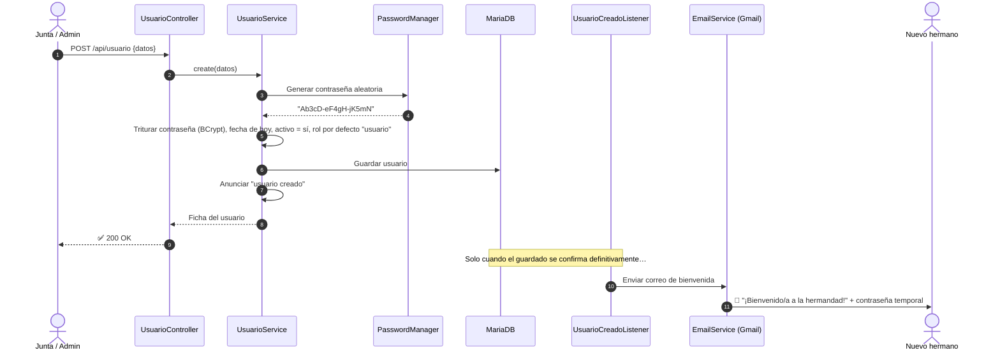

El correo tiene un diseño HTML sencillo: título *"Tu cuenta ha sido creada"*, un saludo con el nombre, la contraseña temporal en un recuadro y la recomendación de cambiarla al entrar.

### 11.2. Cambio de contraseña

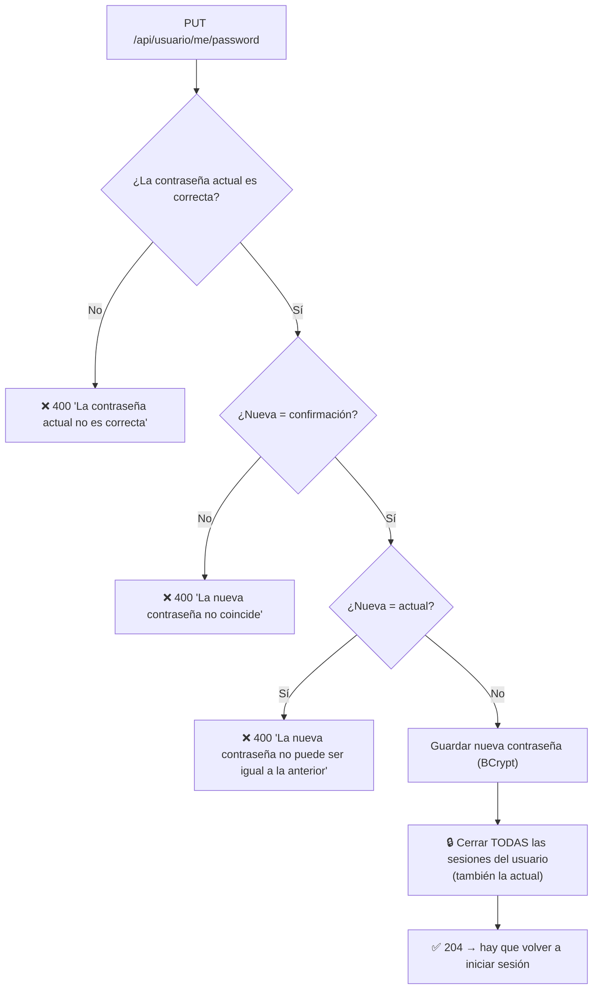

### 11.3. Montar el cuadrante de una salida

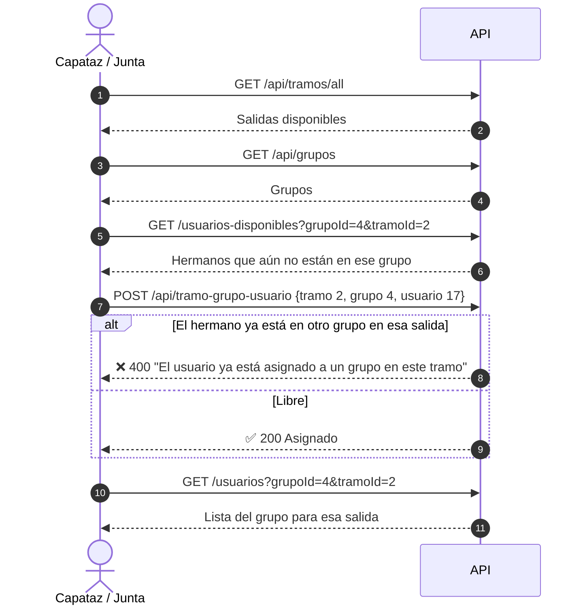

### 11.4. Publicar una noticia con foto

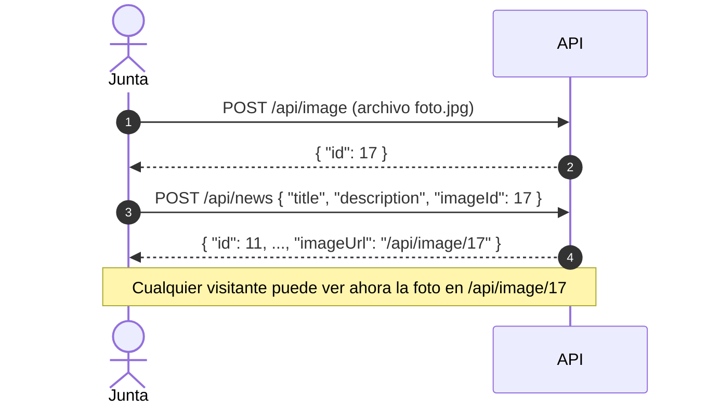

---

## 12. Reglas de negocio

| # | Regla | Dónde se aplica | Qué pasa si se incumple |
|:-:|---|---|---|
| 1 | El email de un usuario es único | Base de datos | Error 500 |
| 2 | Al crear un usuario, la contraseña la genera el sistema y se envía por correo | `UsuarioService` | — |
| 3 | Si no se indica rol, el nuevo usuario es `usuario` | `UsuarioMapper` | — |
| 4 | Dar de baja no borra: pone `activo = false` | `UsuarioService.invalidate` | — |
| 5 | Un usuario solo puede editar de sí mismo email, teléfono y dirección | `UsuarioService.updateSelf` | — |
| 6 | Para cambiar la contraseña hay que saber la actual, repetir la nueva y que sea distinta | `UsuarioService.changePassword` | Error 400 |
| 7 | Cambiar la contraseña cierra todas las sesiones | `SesionRepository.invalidateAllByUserId` | — |
| 8 | En un tramo, la fecha de entrada no puede ser anterior a la de salida | `MethodUtils.validateDates` | 400 "La fecha de entrada no puede ser anterior a la de salida" |
| 9 | Un tramo nuevo no puede estar a menos de 1 día de la **fecha de entrada** de otro tramo existente | `MethodUtils.validateNoOvverlap` | 400 "Tramo solapado" |
| 10 | Un hermano solo puede estar en **un grupo por tramo** | `TramoGrupoUsuarioService` | 400 |
| 11 | Eventos por mes: el mes debe estar entre 1 y 12 | `EventoService` | 400 |
| 12 | Un evento puede no tener grupo (evento general) | `EventoService` | — |
| 13 | Solo se aceptan imágenes PNG o JPEG, no vacías, de hasta 15 MB | `ImageService` + configuración | 400 |
| 14 | Al cambiar la imagen de una noticia o grupo, la vieja se borra | `NoticiaService`, `GrupoService` | — |
| 15 | La fecha de una noticia la pone la base de datos (hoy) | Tabla `noticia` | — |
| 16 | Las sesiones caducan a las 24 horas | `jwt.expiration` | 401 "Sesión expirada" |

### 12.1. Ejemplo de la regla de tramos solapados

Si ya existe un tramo con **entrada el 10 de febrero**, se rechaza cualquier tramo nuevo cuyas fechas toquen el intervalo **9 – 11 de febrero**:

| Tramo nuevo (salida → entrada) | ¿Se acepta? |
|---|:-:|
| 05/02 → 08/02 | ✅ |
| 08/02 → 09/02 | ❌ toca el día 9 |
| 10/02 → 10/02 | ❌ |
| 11/02 → 12/02 | ❌ toca el día 11 |
| 12/02 → 12/02 | ✅ |

---

## 13. Cuando algo sale mal: errores

Todas las respuestas de error tienen **el mismo formato**:

```json
{
  "timestamp": "2026-02-14T18:38:58.123Z",
  "status": 404,
  "error": "404 NOT_FOUND",
  "message": "Grupo no encontrado",
  "path": "/api/grupos/99"
}
```

| Código | Nombre | Significado para el usuario | Ejemplos |
|:-:|---|---|---|
| **200** | OK | Todo ha ido bien | Consultas, creaciones, modificaciones |
| **204** | Sin contenido | Hecho, no hay nada que devolver | Borrados, cambio de contraseña |
| **400** | Petición incorrecta | Los datos enviados no son válidos | Tramo solapado, contraseña no coincide, imagen no PNG/JPEG |
| **401** | No autorizado | No has iniciado sesión o tu pulsera no vale | Token inválido, caducado, otra IP/navegador |
| **403** | Prohibido | Has entrado, pero tu rol no permite eso | Un `usuario` intentando crear una noticia |
| **404** | No encontrado | Eso que buscas no existe | Grupo, tramo, imagen o usuario inexistente |
| **500** | Error interno | Algo ha fallado en el servidor | Email repetido, contraseña incorrecta al entrar, borrar un tramo con asignaciones |

### 13.1. Mensajes de error predefinidos

| Mensaje | Cuándo aparece |
|---|---|
| "Usuario no encontrado" | El usuario no existe |
| "Noticia no encontrad" *(sic)* | La noticia no existe (también se usa, por error, para eventos y en el login) |
| "Grupo no encontrado" | El grupo no existe |
| "Tramo no encontrado" | El tramo no existe |
| "Imágen no encontrada" | La imagen no existe |
| "Tramo solapado" | Fechas que chocan con otro tramo |
| "La fecha de entrada no puede ser anterior a la de salida" | Fechas al revés |
| "El usuario ya está asignado a un grupo en este tramo" | Asignación duplicada |
| "Asignación no encontrada" | Quitar una asignación que no existe |
| "El mes debe estar entre 1 y 12" | Mes incorrecto |
| "El archivo de imagen es obligatorio" / "Solo se permiten imágenes PNG o JPEG" | Subida de imagen incorrecta |
| "La contraseña actual no es correcta" / "La nueva contraseña no coincide" / "…no puede ser igual a la anterior" | Cambio de contraseña |
| "Bearer token vacío" / "Token inválido" / "Sesión expirada" / "Fingerprint inválido" | Problemas con la sesión |

---

## 14. Cómo ponerla en marcha

### 14.1. Requisitos

| Necesitas | Para qué | ¿Obligatorio? |
|---|---|:-:|
| **Java 17** o superior | Ejecutar la API | ✅ |
| **Docker Desktop** | Levantar la base de datos (y opcionalmente la API) | Recomendado |
| MariaDB instalada | Solo si no usas Docker | Alternativa |
| Conexión a internet | Descargar dependencias la primera vez y enviar correos | ✅ |

*No hace falta instalar Maven: el proyecto trae su propio Maven portátil (`mvnw`).*

### 14.1 bis. Preparar las claves secretas (archivo `.env`)

Las contraseñas y claves **no están en el código**: se leen de un archivo `.env` que solo existe en tu ordenador y que git ignora.

```bash
# 1. Copiar la plantilla
cp .env.example .env

# 2. Generar una clave para los tokens
openssl rand -base64 32

# 3. Abrir .env y rellenar los tres valores
```

| Variable | Qué es | Ejemplo |
|---|---|---|
| `MAIL_USERNAME` | Cuenta de Gmail que envía los correos | `cuenta@gmail.com` |
| `MAIL_PASSWORD` | **Contraseña de aplicación** de Google (no la contraseña normal), sin comillas | `abcd efgh ijkl mnop` |
| `JWT_SECRET` | Clave para firmar los tokens (Base64, mínimo 32 bytes) | Resultado de `openssl rand -base64 32` |

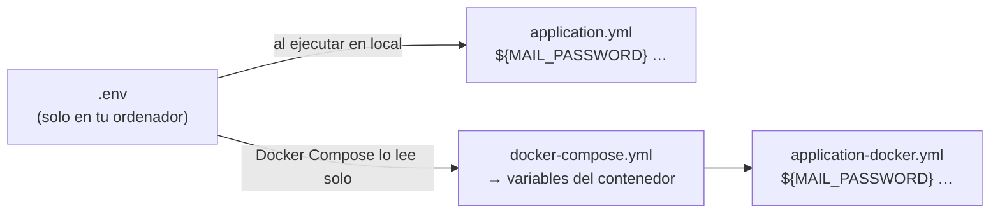

> ⚠️ Si falta alguna de las tres variables, la API **no arranca** y muestra un error del tipo `Could not resolve placeholder 'JWT_SECRET'`. Es intencionado, para no funcionar nunca sin claves.
>
> ℹ️ El archivo `.env` se busca en la carpeta desde la que se lanza la API: ejecútala desde la raíz del proyecto. Si lo prefieres, también puedes definir esas tres variables directamente en el sistema o en tu IDE.

### 14.2. Opción A — Todo con Docker (lo más sencillo)

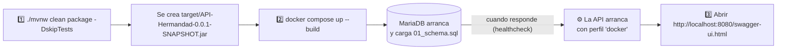

```bash
# 0. Tener el archivo .env preparado (ver 14.1 bis)

# 1. Compilar y empaquetar la API (el Dockerfile necesita este .jar)
./mvnw clean package -DskipTests

# 2. Levantar base de datos + API
docker compose up --build

# 3. Abrir la documentación interactiva
open http://localhost:8080/swagger-ui.html
```

| Servicio | Puerto | Usuario BD | Contraseña BD |
|---|:-:|---|---|
| MariaDB | `3306` | `hermandad` (root: `root`) | `hermandad` (root: `root`) |
| API | `8080` | — | — |

> ⚠️ La base de datos solo se carga con los datos de ejemplo **la primera vez** (cuando el volumen `mariadb_data` está vacío). Para empezar de cero: `docker compose down -v`.

### 14.3. Opción B — Base de datos en Docker y API en tu ordenador

Útil mientras se programa:

```bash
# 1. Levantar solo la base de datos
docker compose up -d mariadb

# 2. Arrancar la API (usa application.yml → localhost:3306)
./mvnw spring-boot:run
```

En Windows, usa `mvnw.cmd` en lugar de `./mvnw`.

### 14.4. Primeros pasos con la API

```bash
# Iniciar sesión con el administrador de ejemplo
curl -X POST http://localhost:8080/api/auth/login \
  -H "Content-Type: application/json" \
  -d '{"email":"admin@email.com","password":"admin"}'

# Guardar el token devuelto y usarlo
TOKEN="pega_aquí_el_token"

curl http://localhost:8080/api/auth/me -H "Authorization: Bearer $TOKEN"

# Consultas públicas (sin token)
curl http://localhost:8080/api/news/all
curl "http://localhost:8080/api/events/month?year=2026&month=3"

# Subir una imagen
curl -X POST http://localhost:8080/api/image \
  -H "Authorization: Bearer $TOKEN" \
  -F "image=@foto.jpg"
```

> ℹ️ **Importante sobre la huella:** el token solo funciona desde la misma IP y el mismo "navegador" (cabecera `User-Agent`) con los que se inició sesión. Si haces login con `curl` y luego usas el token desde Swagger o Postman, te dará *"Fingerprint inválido"*. Inicia sesión desde la misma herramienta que vayas a usar.

### 14.5. Usuarios de prueba

| Email | Contraseña | Rol | Disponible en |
|---|---|---|---|
| `admin@email.com` | `admin` | `admin` | `01_schema.sql` (Docker), `02_data.sql` y `bbdd/hermandad.sql` |
| `junta@email.com` | `admin` | `junta` | Solo `bbdd/hermandad.sql` |
| `capataz@email.com` | `admin` | `capataz` | Solo `bbdd/hermandad.sql` |
| `ususario@email.com` *(sic)* | `admin` | `usuario` | Solo `bbdd/hermandad.sql` |
| `admin2@email.com` | `admin` | `admin` | Solo `bbdd/hermandad.sql` |

*Todos los usuarios de prueba comparten la misma contraseña guardada (el mismo hash BCrypt).*

> ⚠️ Son credenciales **solo para desarrollo**. Si la API se instala en un servidor real, cambia la contraseña del administrador nada más entrar (`PUT /api/usuario/me/password`) o elimina estos usuarios de prueba.

---

## 15. Configuración

Hay dos archivos de configuración casi idénticos. La única diferencia es **dónde busca la base de datos**:

| Archivo | Cuándo se usa | Base de datos |
|---|---|---|
| `application.yml` | Al ejecutar en tu ordenador | `localhost:3306` |
| `application-docker.yml` | Dentro de Docker (`SPRING_PROFILES_ACTIVE=docker`) | `mariadb:3306` (nombre del contenedor) |

| Ajuste | Valor | Qué controla |
|---|---|---|
| `spring.datasource.url` | `jdbc:mariadb://…/hermandad` | Dónde está la base de datos |
| `spring.datasource.username` / `password` | `hermandad` / `hermandad` | Usuario de la base de datos |
| `spring.jpa.hibernate.ddl-auto` | `none` | La API **no** crea ni modifica tablas; las crea el SQL |
| `spring.jpa.show-sql` | `true` | Muestra en consola las consultas SQL (útil para depurar) |
| `spring.mail.host` / `port` | `smtp.gmail.com` / `587` | Servidor de correo |
| `spring.config.import` | `optional:file:.env[.properties]` | Carga los secretos del archivo `.env` si existe |
| `spring.mail.username` / `password` | `${MAIL_USERNAME}` / `${MAIL_PASSWORD}` | Cuenta que envía los correos (desde `.env`) |
| `spring.servlet.multipart.max-file-size` | `15MB` | Tamaño máximo de imagen |
| `jwt.secret` | `${JWT_SECRET}` | Clave con la que se firman los tokens (desde `.env`) |
| `jwt.expiration` | `86400000` (24 h) | Duración de la sesión |
| `server.port` | `8080` | Puerto de la API |

**Configuración que está en el código (no en los `.yml`):**

| Qué | Dónde | Valor actual |
|---|---|---|
| Webs autorizadas (CORS) | `SecurityConfig` | `http://localhost:4200`, `http://192.168.1.X:4200`, `http://192.168.1.X:4201` (las dos últimas son plantillas a completar) |
| Direcciones públicas | `SecurityConfig` y `SessionAuthenticationFilter` | Swagger, login y GET de eventos, noticias e imágenes |

> 🔐 Las claves del correo y de los tokens se leen de variables de entorno o del archivo `.env` (ver [14.1 bis](#141-bis-preparar-las-claves-secretas-archivo-env)). Nunca las escribas directamente en los `.yml`.

---

## 16. Datos de ejemplo incluidos

El archivo `docker/init/01_schema.sql` (el que carga Docker) contiene:

| Tabla | Registros | Contenido |
|---|:-:|---|
| `usuario` | 1 | `admin@email.com` / contraseña `admin`, rol `admin` |
| `grupo` | 9 | Cruz de Guía, Nazarenos Cristo, Acólitos Cristo, Paso Cristo, Banda Cristo, Nazarenos Virgen, Acólitos Virgen, Paso Virgen, Banda Virgen |
| `tramo` | 3 | "Salida procesional del Martes" (10/02/2026), "Martes" (12/02/2026), "Miercoles" (16/02/2026) |
| `evento` | 7 | Igualá, ensayos, traslado del Paso Cristo, fiesta de la cerveza… |
| `noticia` | 2 | Noticias de prueba |
| `tramo_grupo_usuario` | 3 | Asignaciones de prueba |
| `image`, `sesiones` | 0 | Vacías |

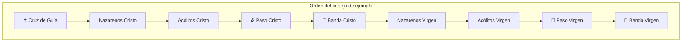

**Otros archivos SQL:**

| Archivo | Para qué | ¿Lo usa Docker? |
|---|---|:-:|
| `docker/init/01_schema.sql` | Estructura + datos de ejemplo | ✅ |
| `docker/init/02_data.sql` | Solo el usuario admin (ya incluido en el 01) | ❌ |
| `bbdd/hermandad.sql` | Copia más completa, con 5 usuarios de prueba (`admin`, `junta`, `capataz`, `usuario` y un segundo administrador) | ❌ |

> ⚠️ En los datos de ejemplo de Docker hay asignaciones y noticias que apuntan a usuarios (ids 4 y 17) e imágenes (ids 5 y 9) **que no existen** en ese archivo. Además, el evento 6 tiene una descripción con lenguaje malsonante que conviene limpiar.

---

## 17. Problemas conocidos y puntos a mejorar

Revisión honesta del código actual. Prioridad: 🔴 alta · 🟠 media · 🟡 baja.

### 17.1. Seguridad

| Prio. | Problema | Explicación | Propuesta |
|:-:|---|---|---|
| 🔴 | **Claves que estuvieron publicadas** | Ya no están en el código ni en el historial (se leen de `.env`), pero estuvieron publicadas un tiempo | Revocar la contraseña de aplicación de Gmail antigua y generar una clave JWT nueva |
| 🟠 | Usuarios de prueba con contraseña trivial (`admin`) | Los usuarios de ejemplo entran con `admin` | Cambiarla o eliminarlos antes de un despliegue real |
| 🔴 | **Los usuarios dados de baja pueden seguir entrando** | El login no comprueba `activo`, y dar de baja no cierra sus sesiones | Comprobar `activo` en login y en el filtro; cerrar sesiones al dar de baja |
| 🟠 | No existe "cerrar sesión" | No hay endpoint de logout; la sesión solo muere al caducar o al cambiar contraseña | Añadir `POST /api/auth/logout` que marque la sesión inactiva |
| 🟠 | Cualquier usuario con sesión puede subir imágenes | `POST /api/image` no exige rol | Restringir a `@AllowedRoles` / `@AllEditRoles` |
| 🟡 | Nombre sin "escapar" en el correo HTML | El nombre se inserta tal cual en el HTML del correo | Escapar caracteres HTML |
| 🟡 | La huella IP+navegador puede expulsar a usuarios móviles | Cambiar de wifi a datos invalida la sesión | Valorar usar solo el navegador, o permitir renovar |
| 🟡 | CORS con direcciones de plantilla | `192.168.1.X` no es una IP válida | Configurarlas desde el `.yml` |

### 17.2. Funcionamiento

| Prio. | Problema | Explicación | Propuesta |
|:-:|---|---|---|
| 🔴 | **Modificar un tramo casi siempre falla con "Tramo solapado"** | Al comprobar solapes, el tramo se compara **consigo mismo** | Excluir el propio tramo de la comprobación en `update` |
| 🟠 | La comprobación de solapes es incompleta | Solo mira la fecha de **entrada** de los tramos existentes, no el intervalo completo | Comparar intervalos salida–entrada |
| 🟠 | Crear un evento **sin grupo** puede fallar | La entidad `Evento` marca el grupo como obligatorio (`optional = false`), aunque la BD y el servicio lo permiten vacío | Quitar `optional = false` y `nullable = false` de `Evento.grupo` |
| 🟠 | Contraseña incorrecta en el login devuelve **500** | Lanza un error genérico | Devolver 401 "Credenciales incorrectas" |
| 🟠 | Email inexistente en el login devuelve **404 "Noticia no encontrad"** | Mensaje equivocado y revela si el email existe | Devolver 401 genérico |
| 🟠 | Borrar un tramo con asignaciones da **500** | La BD lo impide (sin cascada) | Borrar antes sus asignaciones o devolver 409 con un mensaje claro |
| 🟠 | Email duplicado al crear/editar usuario da **500** | No se comprueba antes | Comprobar y devolver 409 "El email ya existe" |
| 🟠 | Si falla el envío del correo, el usuario queda creado sin conocer su contraseña | El correo se envía tras guardar | Reintentos, o endpoint para regenerar contraseña |
| 🟡 | "Usuarios disponibles" incluye a quien ya está en otro grupo del mismo tramo y a los dados de baja | La consulta solo excluye a los de ese grupo | Excluir a los asignados en el tramo y a los inactivos |
| 🟡 | Mensajes de error equivocados en eventos | Usan "Noticia no encontrad" | Crear `NOT_FOUND_EVENT` y corregir la errata |
| 🟡 | La fecha de la noticia no se devuelve | `NoticiaDto` no tiene `fecha` | Añadir el campo |
| 🟡 | Imágenes huérfanas | Si se sube una imagen y no se usa, queda guardada para siempre | Limpieza periódica |
| 🟡 | Restricción única distinta en código y BD | La entidad declara (tramo, usuario); la BD tiene (tramo, grupo, usuario) | Unificar |

### 17.3. Calidad y mantenimiento

| Prio. | Punto | Propuesta |
|:-:|---|---|
| 🟠 | No hay **tests automáticos** | Añadir tests de servicios y de seguridad |
| 🟠 | No se validan los datos de entrada (campos vacíos, formato de email/DNI) | Añadir `spring-boot-starter-validation` y `@Valid` |
| 🟡 | Las imágenes se guardan dentro de la BD | Para muchas imágenes, valorar almacenamiento de archivos externo |
| 🟡 | `show-sql: true` también en Docker | Desactivarlo fuera de desarrollo |
| 🟡 | La función de "huella" está duplicada (`AuthService` y el filtro) | Moverla a una utilidad común |
| 🟡 | El Dockerfile exige compilar antes a mano | Usar un Dockerfile de dos fases que compile dentro |
| 🟡 | Los listados no tienen paginación | Añadir paginación cuando crezcan los datos |
| 🟡 | Nombres mezclados español/inglés (`finguer_print`, `validateNoOvverlap`, `NOT_FOUND_USSER`) | Unificar y corregir erratas |

---

## 18. Ideas para el futuro

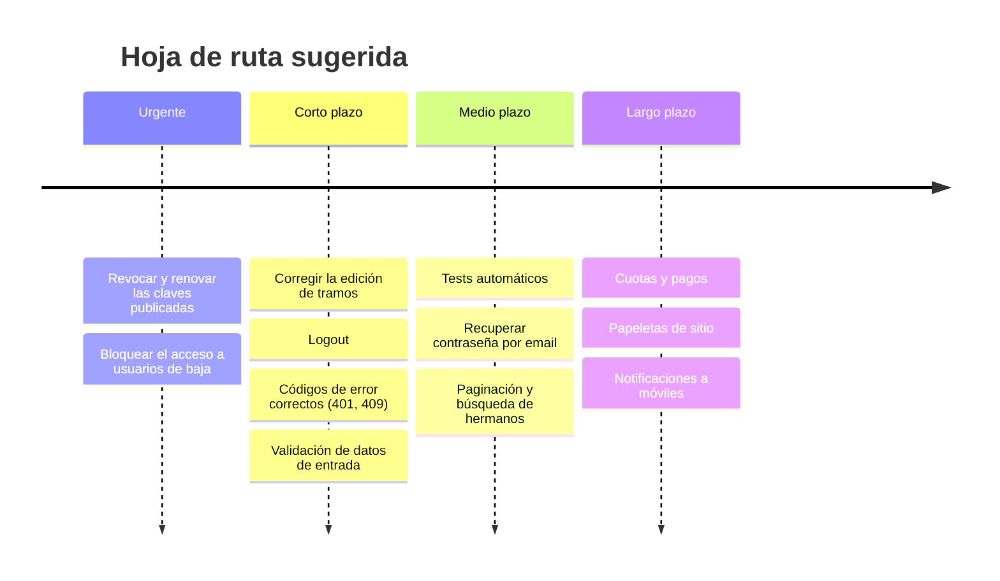

---

## 19. Preguntas frecuentes

<details>
<summary><b>¿Tiene pantallas esta aplicación?</b></summary>

No. Es solo la parte "de atrás" (servidor). Las pantallas las pone otra aplicación (por la configuración, una web Angular en el puerto 4200) que no está en este repositorio. Para probarla sin esa web, usa Swagger en `http://localhost:8080/swagger-ui.html`.
</details>

<details>
<summary><b>¿Cómo doy de alta al primer administrador?</b></summary>

Los datos de ejemplo ya traen uno: `admin@email.com` con contraseña `admin`. Entra con él, cambia su contraseña y, desde ahí, da de alta al resto de hermanos con `POST /api/usuario`.
</details>

<details>
<summary><b>Un hermano nuevo dice que no le ha llegado el correo</b></summary>

Revisa la carpeta de spam. Si no está, puede que haya fallado el envío (credenciales de Gmail caducadas, sin internet…). El usuario se crea igualmente; ahora mismo no existe un botón para reenviar la contraseña, así que habría que cambiarla a mano.
</details>

<details>
<summary><b>Me sale "Fingerprint inválido"</b></summary>

Estás usando el token desde una red o un navegador/herramienta distintos de los que usaste para iniciar sesión. Vuelve a iniciar sesión desde donde estás.
</details>

<details>
<summary><b>Me sale "Sesión expirada"</b></summary>

Han pasado más de 24 horas desde que iniciaste sesión. Vuelve a entrar.
</details>

<details>
<summary><b>He cambiado mi contraseña y me ha echado</b></summary>

Es intencionado: por seguridad se cierran todas tus sesiones abiertas, en todos los dispositivos. Entra de nuevo con la contraseña nueva.
</details>

<details>
<summary><b>¿Por qué un capataz no puede crear salidas (tramos)?</b></summary>

Porque crear, modificar y borrar tramos está reservado exclusivamente al rol `admin`. El capataz sí puede organizar quién va en cada grupo dentro de esas salidas.
</details>

<details>
<summary><b>¿Se pueden poner dos veces a la misma persona en una salida?</b></summary>

No. Cada hermano solo puede estar en un grupo por tramo.
</details>

<details>
<summary><b>¿Dónde se guardan las fotos?</b></summary>

Dentro de la propia base de datos, comprimidas. Por eso para hacer una copia de seguridad completa basta con copiar la base de datos.
</details>

<details>
<summary><b>¿Qué pasa si borro un grupo?</b></summary>

Se borran también sus eventos del calendario, las asignaciones de hermanos a ese grupo y su imagen. Los hermanos no se borran.
</details>

---

<p align="center"><sub>Proyecto <b>API-Hermandad</b> · versión 0.0.1-SNAPSHOT · Java 17 · Spring Boot 4</sub></p>
